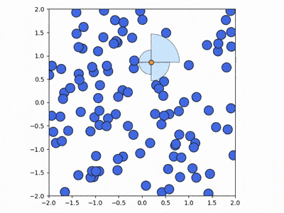

# XY Universe: 2D particle survival environment

We provide here XY Universe, a 2D particle survival environment for training your DRL agents to stay alive as long as possible by avoiding collisions with "bad" particles. The agent and the "bad" particles are confined to a 2D box, move with random constant velocity, and experience elastic collisions against the 2D box walls. This survival environment was inspired by [Karpathy's Waterworld environment](http://cs.stanford.edu/people/karpathy/reinforcejs/waterworld.html).

<p align="center">

</p>

#### Agent reward scheme: 
* +1 for every time step alive
* -100 for colliding into "bad" particle

#### Episode termination condition:
* Agent collision with any "bad" particle

### Usage

Run
```
python3 XY_universe.py
```

### Libraries required

* tensorflow, keras, numpy, scipy, matplotlib, h5py, ffmpeg, tkinter

### Authors

Anson Wong